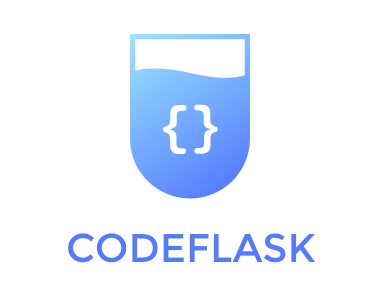
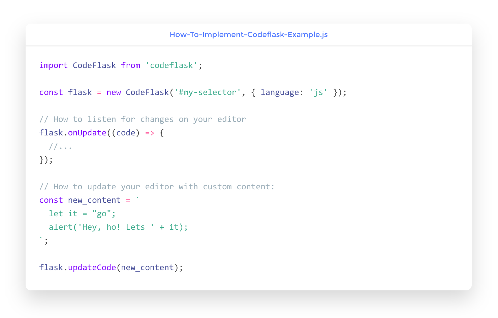

[](https://www.npmjs.com/package/codeflask)
[](https://travis-ci.org/kazzkiq/CodeFlask)

<p align="center">
  <br>
    CodeFlask: A micro code-editor for awesome web pages.
</p>

<p align="center">
  
</p>

## Installation

You can install CodeFlask via npm:

```
npm install codeflask
```

Or use it directly in browser via cdn service:

```
https://unpkg.com/codeflask/build/codeflask.min.js
```

## Usage

```js
import CodeFlask from 'codeflask';

const flask = new CodeFlask('#my-selector', { language: 'js' });
```
You can also pass a DOM element instead of a selector:
```js
import CodeFlask from 'codeflask';

const editorElem = document.getElementById('editor');
const flask = new CodeFlask(editorElem, { language: 'js' });
```
Usage with Shadow DOM:
```js
import CodeFlask from 'codeflask';
...
const shadowElem = this.shadowRoot.querySelector('#editor');
const flask = new CodeFlask(shadowElem, { language: 'js', styleParent: this.shadowRoot });
```
### Listening for changes in editor

```js
flask.onUpdate((code) => {
  // do something with code here.
  // this will trigger whenever the code
  // in the editor changes.
});
```

### Updating the editor programatically

```js
// This will also trigger .onUpdate()
flask.updateCode('const my_new_code_here = "Blabla"');
```

### Getting the current code from editor

```js
const code = flask.getCode();
```

### Enabling line numbers

```js
import CodeFlask from 'codeflask';

const flask = new CodeFlask('#my-selector', {
  language: 'js',
  lineNumbers: true
});
```

### Enabling rtl (right to left writing)

```js
import CodeFlask from 'codeflask';

const flask = new CodeFlask('#my-selector', {
  language: 'js',
  rtl: true
});
```

### Enabling read only mode

```js
import CodeFlask from 'codeflask';

const flask = new CodeFlask('#my-selector', {
  language: 'js',
  readonly: true
});
```

### Adding other languages support:

```js
flask.addLanguage('ruby', options)
```

#### For Example to add 'Ruby'

```js
import Prism from 'prismjs';
import CodeFlask from 'codeflask';

const flask = new CodeFlask('#my-selector', {
  language: 'ruby',
  readonly: true
});

flask.addLanguage('ruby', Prism.languages['ruby']);
```

This API is simply a proxy to add a new language to [Prism](http://prismjs.com/) itself (the code highlighter). The `options` parameter must be the same accepted in Prism. You can read more about it [here](http://prismjs.com/extending.html#language-definitions).

By default, CodeFlask supports the following languages (which are also the default supported in Prism):

- Markup (HTML/XML);
- CSS;
- C-like;
- JavaScript;

### Adding your own theme to CodeFlask

By default, CodeFlask comes with a simple theme made from scratch called **[CodeNoon](https://github.com/kazzkiq/CodeFlask.js/blob/master/src/styles/theme-default.js)**.

You can easily override this theme with your own by writting your own CSS and adding it to your project. If that's the case, you should also disable **CodeNoon** with the `defaultTheme` option:

```js
import CodeFlask from 'codeflask';

const flask = new CodeFlask('#my-selector', {
  language: 'js',
  defaultTheme: false
});
```

# Credits & Thanks

CodeFlask.js was made possible by awesome open-source projects such as [Prism.js](https://github.com/PrismJS/prism) and [Rollup](https://github.com/rollup/rollup).


## 🌐 Web Resources & Interactive Index
- [CATEGORY STRATEGY](https://thelearnquesters.pages.dev/category-strategy.html)
- [PARK THEM ALL](https://ilearnworldjp.pages.dev/park-them-all.html)
- [GRILL IT ALL](https://thequizzone.pages.dev/grill-it-all.html)
- [CATEGORY WORLD CUP17](https://learnquester.github.io/category-world-cup17.html)
- [BEST FRIENDS PUZZLE](https://thelearnquesters.pages.dev/best-friends-puzzle.html)
- [MATRIX TYPER](https://themindzone.pages.dev/matrix-typer.html)
- [FLICK BASEBALL SUPER HOMERUN](https://studyquests.pages.dev/flick-baseball-super-homerun.html)
- [HERO RABBIT IDLE SURVIVOR RPG](https://thelearnquesters.pages.dev/hero-rabbit-idle-survivor-rpg.html)
- [HAPPY EGG CATCH](https://quizverses.github.io/happy-egg-catch.html)
- [CROWN CANNON](https://quizverses-9d2f2.web.app/crown-cannon.html)
- [CATEGORY CAR 2](https://quizverses.pages.dev/category-car-2.html)
- [CATEGORY PUZZLE 9](https://theskillquest.pages.dev/category-puzzle-9.html)
- [ENCHANTED MAHJONG SAGA](https://quizverses.pages.dev/enchanted-mahjong-saga.html)
- [CATEGORY BUBBLE SHOOTER27](https://quizverses.github.io/category-bubble-shooter27.html)
- [SNAKE HUNTER](https://quizverses.pages.dev/snake-hunter.html)
- [SEA LORDS](https://thelearnquesters.pages.dev/sea-lords.html)
- [SCREW NUTS BOLTS WOOD SOLVE](https://thelearnquesters.pages.dev/screw-nuts-bolts-wood-solve.html)
- [HOLE DEFENSE](https://quizverses-9d2f2.web.app/hole-defense.html)
- [CATEGORY FIGHTING124](https://thequizzone.pages.dev/category-fighting124.html)
- [BFF LOVELY KAWAII OUTFITS](https://quizverses.pages.dev/bff-lovely-kawaii-outfits.html)
- [GEOMETRY OPEN WORLD](https://thequizzone.pages.dev/geometry-open-world.html)
- [SAVE HER TOUR](https://themindzone.pages.dev/save-her-tour.html)
- [CATEGORY 2D1 070](https://quizverses.github.io/category-2d1-070.html)
- [SEEK FIND](https://thelearnquesters.pages.dev/seek-find.html)
- [DAILY MATCH](https://quizverses.github.io/daily-match.html)
- [HEAD JUMP](https://thequizzone.pages.dev/head-jump.html)
- [RENT OUT LANDLORD TYCOON](https://quizverses-9d2f2.web.app/rent-out-landlord-tycoon.html)
- [LOVIE CHICS COACHELLA FESTIVAL](https://quizverses.github.io/lovie-chics-coachella-festival.html)
- [CATEGORY MOBILE2 095](https://thelearnquesters.pages.dev/category-mobile2-095.html)
- [CATEGORY CASUAL 11](https://theskillquest.pages.dev/category-casual-11.html)
- [GANGSTA ISLAND CRIME CITY](https://quizverses.pages.dev/gangsta-island-crime-city.html)
- [CATEGORY ADVENTURE 4](https://theskillquest.pages.dev/category-adventure-4.html)
- [OCTOPUS INVASION](https://themindzone.pages.dev/octopus-invasion.html)
- [SQUID GAME MEMORY CARD MATCH](https://quizverses-9d2f2.web.app/squid-game-memory-card-match.html)
- [INDEX4](https://quizverses.github.io/index4.html)
- [SUMMER AESTHETICS](https://quizverses.github.io/summer-aesthetics.html)
- [OBBY CARDS THE LEGEND HUNT](https://quizverses-9d2f2.web.app/obby-cards-the-legend-hunt.html)
- [SWEETSU TILE PUZZLE](https://themindzone.pages.dev/sweetsu-tile-puzzle.html)
- [MOJICON FRUIT CONNECT](https://themindzone.pages.dev/mojicon-fruit-connect.html)
- [INDEX28](https://thequizzone.pages.dev/index28.html)
- [ELLIE CHINESE NEW YEAR CELEBRATION](https://themindzone.pages.dev/ellie-chinese-new-year-celebration.html)
- [CYBER MONDAY](https://quizverses.github.io/cyber-monday.html)
- [MATCH ARENA](https://quizverses.pages.dev/match-arena.html)
- [PINTURILLO](https://thequizzone.pages.dev/pinturillo.html)
- [BUBBITS](https://quizverses-9d2f2.web.app/bubbits.html)
- [RED STICKMAN VS MONSTER SCHOOL](https://quizverses.github.io/red-stickman-vs-monster-school.html)
- [TAP HOLD](https://themindzone.pages.dev/tap-hold.html)
- [IDLE MERGE CAR AND RACE](https://themindzone.pages.dev/idle-merge-car-and-race.html)
- [BRAIN FIND CAN YOU FIND IT](https://quizverses.pages.dev/brain-find-can-you-find-it.html)
- [PAINT SPONGES PUZZLE](https://quizverses-9d2f2.web.app/paint-sponges-puzzle.html)
- [COOKIE MONSTER](https://themindzone.pages.dev/cookie-monster.html)
- [ENCHANTED MAHJONG SAGA](https://thelearnquesters.pages.dev/enchanted-mahjong-saga.html)
- [CATEGORY PUZZLE 11](https://themindzone.pages.dev/category-puzzle-11.html)
- [ONU LIVE](https://studyquests.github.io/onu-live.html)
- [ALIEN HUNTERS](https://studyquests.github.io/alien-hunters.html)
- [JUNGLE SOLITAIRE](https://quizverses.pages.dev/jungle-solitaire.html)
- [QUIZ X](https://quizverses.github.io/quiz-x.html)
- [CATEGORY SOCCER60](https://themindzone.pages.dev/category-soccer60.html)
- [SUDOKU BRAIN BLOCKS](https://studyquests.github.io/sudoku-brain-blocks.html)
- [ROBOT TERMINATOR T REX](https://thequizzone.pages.dev/robot-terminator-t-rex.html)
- [FALLLING JEWELS](https://quizverses.github.io/fallling-jewels.html)
- [CATEGORY SKILL254](https://themindzone.pages.dev/category-skill254.html)
- [TAP AWAY BLOCK PUZZLE 3D](https://quizverses.pages.dev/tap-away-block-puzzle-3d.html)
- [RADICAL RAPPELLING](https://thequizzone.pages.dev/radical-rappelling.html)
- [MOTO STUNT BIKER](https://thelearnquesters.pages.dev/moto-stunt-biker.html)
- [CATEGORY SOCCER](https://themindzone.pages.dev/category-soccer.html)
- [WORDS FROM WORDS SEA](https://quizverses.github.io/words-from-words-sea.html)
- [MINI GAMES RELAX COLLECTION 2](https://studyquests.github.io/mini-games-relax-collection-2.html)
- [ONLINE PORTAL](https://brainquests.onrender.com/)
- [HAZEL TANGLE ROPE 3D SORTING PUZZLE](https://studyquests.github.io/hazel-tangle-rope-3d-sorting-puzzle.html)
- [VARIETY MECHA](https://thequizzone.pages.dev/variety-mecha.html)
- [ZOMBIE HIGHWAY RAMPAGE](https://studyquests.github.io/zombie-highway-rampage.html)
- [SUPERMARKET MANAGER SIMULATOR](https://studyquests.github.io/supermarket-manager-simulator.html)
- [LAND CRUISER OFFROAD DRIVER](https://studyquests.github.io/land-cruiser-offroad-driver.html)
- [ASOKA MAKEUP INDIAN BRIDE](https://studyquests.github.io/asoka-makeup-indian-bride.html)
- [FARM MERGE HARVEST](https://studyquests.github.io/farm-merge-harvest.html)
- [ROBOT BAND FIND THE DIFFERENCES](https://themindzone.pages.dev/robot-band-find-the-differences.html)
- [ROBBY BOMBERMAN](https://thelearnquesters.pages.dev/robby-bomberman.html)
- [SPRUNKI 3D SHOOTER](https://quizverses.pages.dev/sprunki-3d-shooter.html)
- [SKATING PARK](https://quizverses-9d2f2.web.app/skating-park.html)
- [WATER DIG RESCUE](https://quizverses.pages.dev/water-dig-rescue.html)
- [SKILLFUL FINGER](https://themindzone.pages.dev/skillful-finger.html)
- [YOUR DREAM ROOM](https://thequizzone.pages.dev/your-dream-room.html)
- [PLANET EVOLUTION IDLE CLICKER](https://studyquests.github.io/planet-evolution-idle-clicker.html)
- [CANDY JEWELS](https://quizverses-9d2f2.web.app/candy-jewels.html)
- [SEA LORDS](https://studyquests.github.io/sea-lords.html)
- [QUEST BY COUNTRY](https://themindzone.pages.dev/quest-by-country.html)
- [MERGE 2048 CAKE](https://quizverses.github.io/merge-2048-cake.html)
- [VALLEY OF WOLVES AMBUSH](https://themindzone.pages.dev/valley-of-wolves-ambush.html)
- [BUTTERFLY KYODAI DELUXE 2](https://thequizzone.pages.dev/butterfly-kyodai-deluxe-2.html)
- [CATEGORY CLASSIC98](https://theskillquest.pages.dev/category-classic98.html)
- [POKER QUEST](https://studyquests.github.io/poker-quest.html)
- [FUN MINI GAMES FOR PRINCESS](https://studyquests.github.io/fun-mini-games-for-princess.html)
- [SOLITAIRE MAHJONG](https://quizverses.pages.dev/solitaire-mahjong.html)
- [OBBY PRISON RUN](https://studyquests.github.io/obby-prison-run.html)
- [IDLE MERGE CAR AND RACE](https://thequizzone.pages.dev/idle-merge-car-and-race.html)
- [ICONIC HALLOWEEN COSTUMES](https://studyquests.github.io/iconic-halloween-costumes.html)
- [CATEGORY CUTE](https://quizverses.github.io/category-cute.html)
- [MINE FPS SHOOTER NOOB ARENA](https://thelearnquesters.pages.dev/mine-fps-shooter-noob-arena.html)
- [HOUSE OF CELESTINA](https://studyquests.github.io/house-of-celestina.html)
- [KINGDOM PUZZLES](https://thequizzone.pages.dev/kingdom-puzzles.html)
- [HUNT AND SEEK](https://thequizzone.pages.dev/hunt-and-seek.html)
- [JUMPER](https://themindzone.pages.dev/jumper.html)
- [THROUGH THE WALL](https://quizverses-9d2f2.web.app/through-the-wall.html)
- [SWEET TRIPLE MAHJONG](https://themindzone.pages.dev/sweet-triple-mahjong.html)
- [LOOP SURVIVORS ZOMBIE CITY](https://studyquests.github.io/loop-survivors-zombie-city.html)
- [DROP BRICKS BREAKER](https://thelearnquesters.pages.dev/drop-bricks-breaker.html)
- [STYLISH NAIL ART](https://themindzone.pages.dev/stylish-nail-art.html)
- [CATEGORY BUILDING182](https://quizverses.github.io/category-building182.html)
- [WEDNESDAY LIGHT ACADEMIA](https://thequizzone.pages.dev/wednesday-light-academia.html)
- [MAHJONG TILE CLUB](https://quizverses.pages.dev/mahjong-tile-club.html)
- [DANCE ON HOTSTEPS MOBILE](https://studyquests.github.io/dance-on-hotsteps-mobile.html)
- [CATEGORY SOCCER 2](https://themindzone.pages.dev/category-soccer-2.html)
- [CARJAMCOLOR](https://quizverses.pages.dev/carjamcolor.html)
- [OBBY RESCUE PIN](https://themindzone.pages.dev/obby-rescue-pin.html)
- [K POP HUNTER HALLOWEEN FASHION](https://themindzone.pages.dev/k-pop-hunter-halloween-fashion.html)
- [CATEGORY COLLECT565](https://theskillquest.pages.dev/category-collect565.html)
- [SUPERMARKET CASHIER SIMULATOR](https://learnquester.github.io/supermarket-cashier-simulator.html)
- [ORDER OF OPERATION CHALLENGE](https://studyplayings.pages.dev/order-of-operation-challenge.html)
- [STOCKINGS DILEMMA](https://quizverses.pages.dev/stockings-dilemma.html)
- [CONSOLE IDLE](https://quizverses-9d2f2.web.app/console-idle.html)
- [FIRE BALL AND WATER BALL PARKOUR LOVE BALLS](https://thelearnquesters.pages.dev/fire-ball-and-water-ball-parkour-love-balls.html)
- [CHAMPIONS FC](https://studyquests.github.io/champions-fc.html)
- [MINI GAMES PUZZLE COLLECTION](https://thequizzone.pages.dev/mini-games-puzzle-collection.html)
- [HELP ME TRICKY BRAIN PUZZLES](https://studyquests.github.io/help-me-tricky-brain-puzzles.html)
- [ROAD OF FURY 4](https://learnquester.pages.dev/road-of-fury-4.html)
- [OIL DIGGING](https://themindzone.pages.dev/oil-digging.html)
- [CATEGORY SPACE](https://quizverses.github.io/category-space.html)
- [MAHJONG QUEST CANDYLAND ADVENTURES](https://thelearnquesters.pages.dev/mahjong-quest-candyland-adventures.html)
- [CATEGORY SIDE SCROLLING184](https://themindzone.pages.dev/category-side-scrolling184.html)
